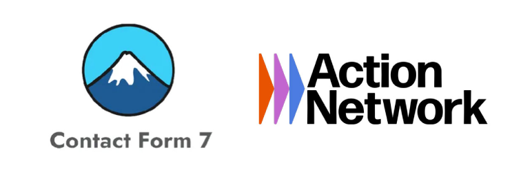
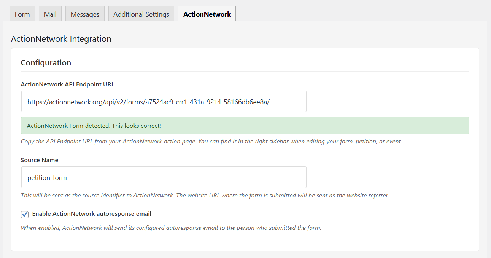
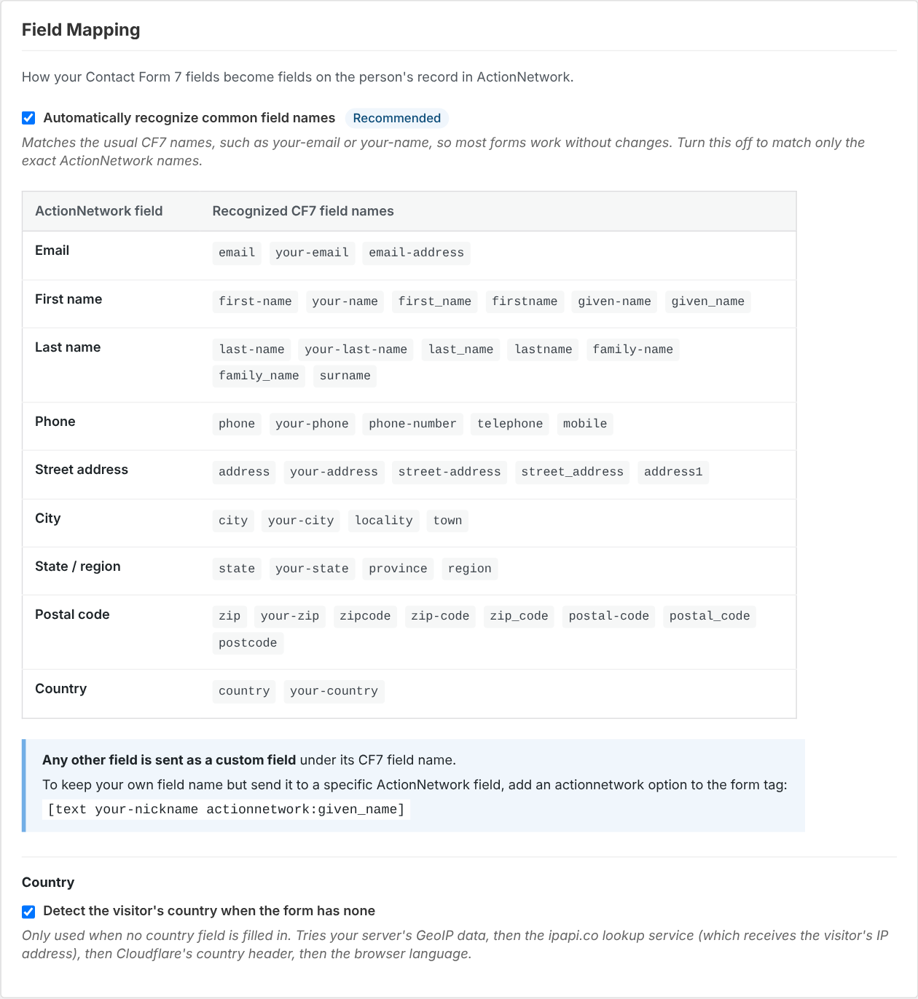
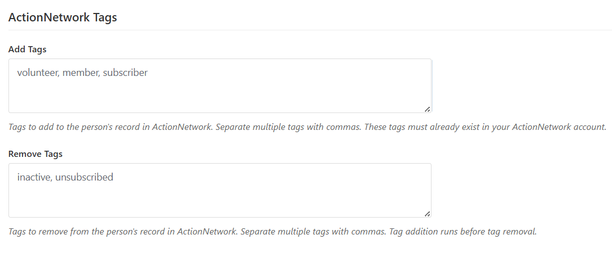

# Form Integration for Action Network and Contact Form 7 #
**Contributors:** [procom.dev](https://procom.dev), [Mário Valney](https://mariovalney.com/me)  
**Tags:** contact form 7, action network, cf7, actionnetwork, integration  
**Official website:** https://github.com/procom-dev/form-integration-for-action-network-and-contact-form-7  
**Requires at least:** 4.7  
**Tested up to:** 7.1.3  
**Stable tag:** trunk  
**Requires PHP:** 7.4  
**License:** GPLv2 or later  
**License URI:** http://www.gnu.org/licenses/gpl-2.0.html  

Send Contact Form 7 submissions to ActionNetwork. The plugin maps your form fields to ActionNetwork's fields, can fill in the visitor's country, and can add or remove tags.

## Description ##

[Contact Form 7 (CF7)](https://wordpress.org/plugins/contact-form-7/) is one of the most common form plugins on WordPress. This plugin takes what people submit through a CF7 form and sends it to an ActionNetwork form, petition, event, fundraising page or advocacy campaign. We built it for nonprofits, advocacy groups and campaigns that already collect sign-ups on their WordPress site and want them to land in ActionNetwork.

What it does:

- Recognizes common field names like `your-email` or `first-name` and maps them to ActionNetwork's person fields.
- Fills in the country when your form doesn't ask for it.
- Adds or removes ActionNetwork tags on each submission.
- Lets you turn ActionNetwork's autoresponse on or off, and skips CF7's own emails so people don't get two.
- Records a source name and the referring URL.
- Retries failed requests with exponential backoff.
- Uses nonces, sanitization and capability checks, as WordPress.org requires.
- Checks the ActionNetwork URL as you type it in the admin screen.

ActionNetwork and the CF7 developers had nothing to do with this plugin.

### How to use it ###

1. Create a Form, Petition, Event, Fundraising Page or Advocacy Campaign in ActionNetwork.
2. While editing it, copy the API Endpoint URL from the right sidebar.
3. In Contact Form 7, open the "ActionNetwork" tab of your form and paste the URL. That's enough to turn the integration on; there's no separate switch.
4. If you want, set up country detection, tags, a source name and autoresponse.

### Supported ActionNetwork actions ###

The plugin works out the action type from the URL and posts to the right endpoint:

- Forms → `/submissions`
- Petitions → `/signatures`
- Events → `/attendances`
- Fundraising pages → `/donations`
- Advocacy campaigns → `/outreaches`

### Field mapping ###

If your CF7 fields use one of these names, the plugin maps them for you:

| CF7 field name | ActionNetwork field |
| --- | --- |
| `your-email`, `email`, `email-address` | Email address |
| `your-name`, `first-name`, `firstname`, `given-name` | First name |
| `your-last-name`, `last-name`, `lastname`, `family-name`, `surname` | Last name |
| `your-phone`, `phone`, `phone-number`, `telephone`, `mobile` | Phone number |
| `your-address`, `address`, `street-address` | Street address |
| `your-city`, `city`, `locality`, `town` | City |
| `your-state`, `state`, `province`, `region` | State/region |
| `your-zip`, `zip`, `zipcode`, `postal-code` | Postal code |
| `your-country`, `country` | Country |

Any other field goes to ActionNetwork as a custom field.

### Other options ###

Country detection looks up the visitor's country from their IP address, CloudFlare's country header, or their browser language.

Tags: give a comma-separated list of tags to add to each new contact, and another of tags to remove. Both run on every submission.

Source tracking: set a source name for the campaign. The plugin also sends the referring URL and picks up `?source=` from the page URL.

### FAQ ###

#### Does it work with Gutenberg and WordPress 6+?
Yes. It works with WordPress 5.0 and later, including the block editor.

#### How do I know it's working?
Submit a test form, then look for the new submission in your ActionNetwork action. Failed requests are retried and logged.

#### Can I use it with webhooks other than ActionNetwork?
No, it only speaks ActionNetwork's API. For generic webhooks, try [CF7 to Webhook](https://github.com/mariovalney/cf7-to-zapier).

#### What happens to file uploads?
The plugin copies uploaded files to a separate directory and sends their URLs to ActionNetwork before CF7 deletes the temporary files.

#### Can I map a field myself?
Yes. Add the `actionnetwork` option to the field tag:
`[text your-field actionnetwork:custom_field_name]`

#### What happens to CF7's emails?
Once an ActionNetwork URL is set, CF7's emails are turned off by default so people don't get duplicates. ActionNetwork's autoresponse has its own setting.

#### How does country detection work?
It tries these in order:
1. GeoIP functions, if your server has them
2. The free ipapi.co service
3. CloudFlare's country header
4. The browser's language settings

#### Can one form send to several ActionNetwork actions?
Yes. Put one URL per line and each one gets the submission.

### Who wrote the original plugin?
[Mário Valney](https://mariovalney.com/me), a Brazilian developer and member of the [WordPress community](https://profiles.wordpress.org/mariovalney).

### Can I help?
Sure. Code, bug reports and ideas are all welcome on [GitHub](https://github.com/procom-dev/form-integration-for-action-network-and-contact-form-7).

## Screenshots ##

*The main settings screen. You only need to paste the Action Network API Endpoint here.*

*The plugin matches your CF7 fields to Action Network's core fields.*

*Adding and removing tags for people who submit the form.*

## Installation ##

1. Install and activate [Contact Form 7](https://wordpress.org/plugins/contact-form-7/).
2. Install "Form Integration for Action Network and Contact Form 7" from the Plugins screen, or upload the `form-integration-for-action-network-and-contact-form-7` folder to `/wp-content/plugins/`.
3. Activate it from the Plugins menu.
4. Open any form in CF7 and you'll see an "ActionNetwork" tab.

## Changelog ##

### 1.0.0 ###
* Rewrote the ActionNetwork API integration.
* Automatic mapping for 25+ common field names.
* Country detection, with several fallback methods.
* Add and remove ActionNetwork tags.
* Nonces, sanitization and capability checks for WordPress.org.
* New admin screen with live URL validation.
* The integration turns on as soon as you add a URL.
* Better referrer and source tracking.
* Exponential backoff when requests fail.
* Settings for ActionNetwork's autoresponse and CF7's emails.
* Send one form to several ActionNetwork actions.
* More logging and better error handling.
* Faster data processing.
